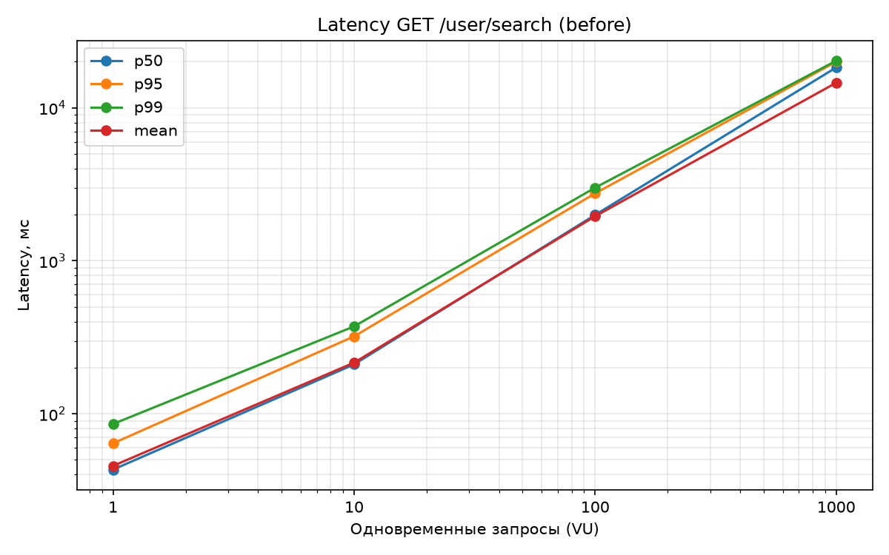
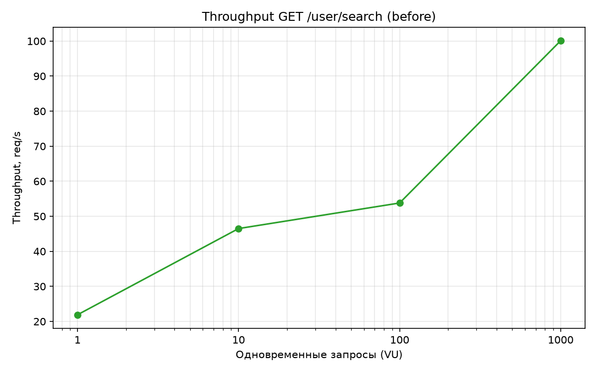
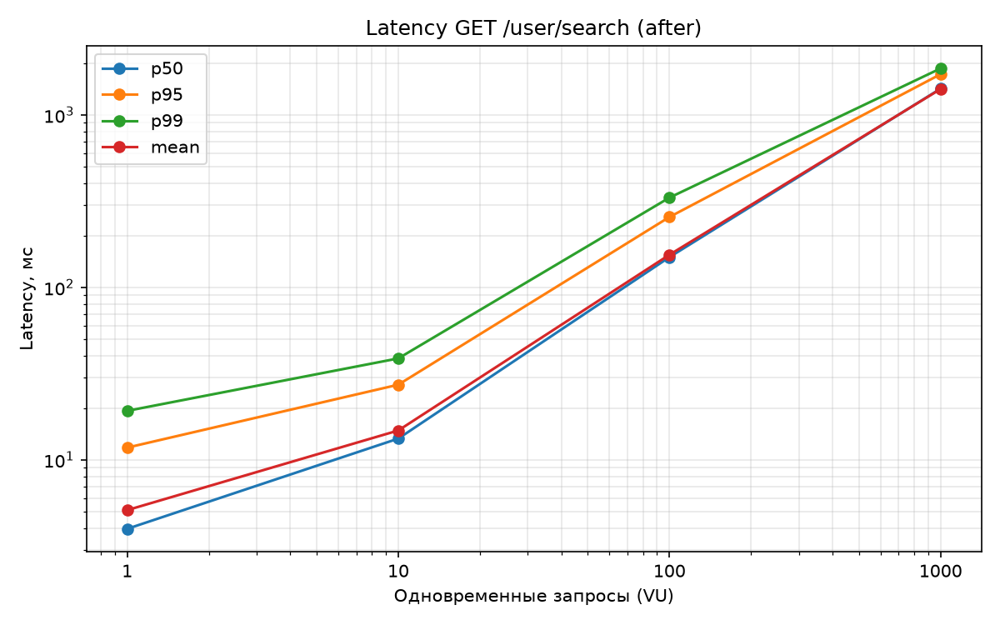
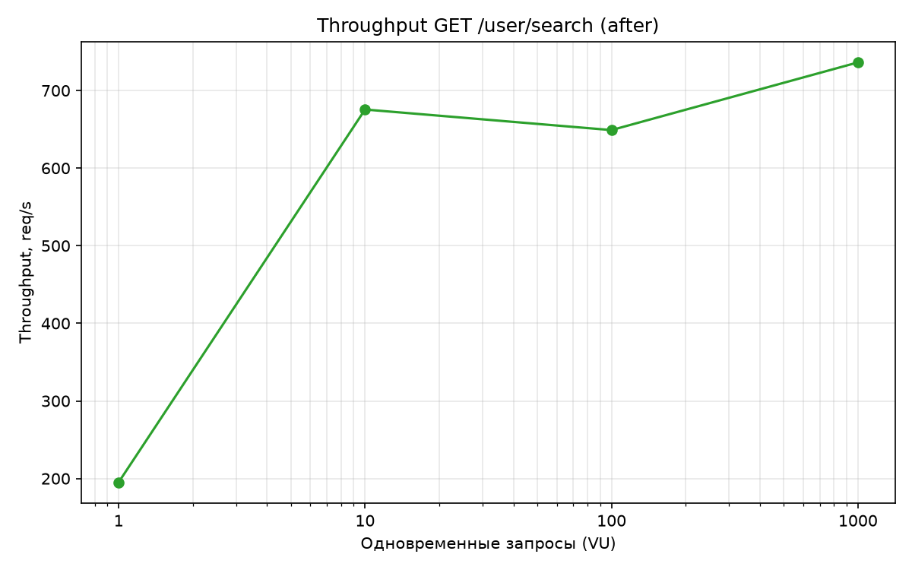

# Отчет: производительность индексов (`/user/search`)

## 1. Подготовка

**Данные.** 999 930 анкет из `test_data/people.v2.csv` (реальные русские имена/фамилии, дата рождения, город) загружены в таблицу `users`. Формат CSV — `Фамилия Имя,YYYY-MM-DD,Город`, поэтому первый токен → `second_name`, второй → `first_name`. Два способа загрузки:
- `scripts/load_data.sh` — `COPY` в staging-таблицу + `INSERT ... SELECT` (использовался для замеров);
- миграция `002-load-test-data.sql` — генерируется `scripts/generate_migration.py`: 500 многострочных `INSERT ... SELECT ... FROM (VALUES)` пачками по 2000 строк, `id`/`password_hash` генерируются на стороне БД, `SET LOCAL synchronous_commit = off`, precondition «только на пустую таблицу» (`MARK_RAN`). Применение Liquibase'ом — ~36 с.

**Метод.** Реализован `GET /user/search?first_name=...&last_name=...` (JWT/Bearer-авторизация как у остальных эндпоинтов):

```sql
SELECT ... FROM users
WHERE first_name LIKE ? ESCAPE '\' AND second_name LIKE ? ESCAPE '\'
ORDER BY id
```

(`dao/UserDao.java`, `service/UserService.java`, `controller/UserController.java`).

**Нагрузочное тестирование.** `scripts/load_test.py` (Python stdlib, потоки): на каждый уровень конкурентности 1/10/100/1000 — 5 c разогрева и 20 c измерений; префиксы (2–4 символа) выбираются случайно из фиксированного набора реальных префиксов имен/фамилий. Графики — `scripts/plot.py` (matplotlib). Среда: PostgreSQL 16 в Docker, приложение Spring Boot 3.3 локально, macOS (Apple Silicon).

## 2. До индекса

### Latency до индекса



### Throughput до индекса



| VU | RPS | p50, мс | p95, мс | p99, мс |
|---:|---:|---:|---:|---:|
| 1 | 21.9 | 43.2 | 64.1 | 85.8 |
| 10 | 46.5 | 210.3 | 320.8 | 372.6 |
| 100 | 53.8 | 1995.0 | 2758.2 | 3005.2 |
| 1000 | 100.1 | 18337.0 | 19992.3 | 20289.0 |

Система деградирует катастрофически: уже при 10 VU latency ×5, при 1000 VU — ~18–20 секунд на запрос. Причина видна в плане:

### EXPLAIN до индекса

```text
Gather Merge  (cost=24516.71..24518.58 rows=16 width=105)
  Workers Planned: 2
  ->  Sort (Sort Key: id)
        ->  Parallel Seq Scan on users
              Filter: (((first_name)::text ~~ 'Конст%'::text)
                   AND ((second_name)::text ~~ 'Оси%'::text))
              Rows Removed by Filter: 333301
              Buffers: shared hit=16232 read=1107
Execution Time: 72.756 ms          -- (холодный кэш: заметно хуже)
```

**Parallel Seq Scan всей таблицы (16 000+ страниц, ~1M строк, все отбрасываются фильтром) на каждый запрос.**

## 3. Индекс

### Запрос добавления индекса

Миграция `002-users-name-prefix-index.sql` (Liquibase):

```sql
CREATE INDEX IF NOT EXISTS idx_users_second_first_name_pattern
    ON users (second_name text_pattern_ops, first_name text_pattern_ops);
```

### Почему индекс именно такой

1. **B-tree + `text_pattern_ops`**. Обычный B-tree по `varchar` с не-C локалью (у нас `ru_RU.UTF-8` — сортировка учитывает язык) **не может** обслуживать `LIKE 'префикс%'`: сравнение префикса не эквивалентно диапазону в лингвистическом порядке. Операторный класс `text_pattern_ops` строит индекс по побайтовому (C-подобному) порядку, при котором `LIKE 'abc%'` эквивалентен диапазону `>= 'abc' AND < 'abd'` — это видно в плане ниже (`Index Cond: ~>=~ / ~<~`). Альтернатива — `LIKE 'abc%'` через индекс с `COLLATE "C"`, эффект тот же.
2. **Составной индекс `(second_name, first_name)`**, а не два отдельных. Оба условия запроса — префиксные, а в запросе нет условия равенства, поэтому два отдельных индекса дали бы Bitmap AND двух больших битмапов; составной индекс позволяет использовать **оба** столбца для сужения диапазона сканирования: сначала отсекаем по фамилии, внутри — по имени.
3. **Фамилия — ведущий столбец.** В реальных данных фамилий (~несколько сотен) заметно меньше, чем имен, т.е. селективность префикса фамилии выше; самый фильтрующий столбец ставим первым.
4. **`ORDER BY id` не индексируем** — после фильтра остается ~десятки–сотни строк, in-memory sort стоит копейки. Индекс по `id` вместе с именами дал бы почти бесполезный (и дорогой в записи) составной ключ.
5. **Префиксный LIKE (`prefix%`)**, а не `%substring%` — по спецификации поиск идет по началу строки, поэтому индекс применим целиком.

Цена: индекс ~86 МБ, замедление вставки в пределах погрешности (для 1M строк построение — 0.7 с).

## 4. После индекса

### EXPLAIN после индекса

```text
Sort (cost=113.46..113.51 rows=18 width=105)  (Sort Key: id)
  ->  Bitmap Heap Scan on users
        Filter: (((first_name)::text ~~ 'Конст%') AND ((second_name)::text ~~ 'Оси%'))
        Heap Blocks: exact=19
        ->  Bitmap Index Scan on idx_users_second_first_name_pattern
              Index Cond: (((second_name)::text ~>=~ 'Оси'::text)
                       AND ((second_name)::text ~<~ 'Осй'::text)
                       AND ((first_name)::text ~>=~ 'Конст'::text)
                       AND ((first_name)::text ~<~ 'Консу'::text))
              Buffers: shared read=7
Execution Time: 0.546 ms     -- было 72.756 мс → ускорение ~130x
```

Seq Scan исчез: вместо 17 000 страниц читается ~26 (7 страниц индекса + 19 страниц данных).

### Latency после индекса



### Throughput после индекса



| VU | RPS | p50, мс | p95, мс | p99, мс |
|---:|---:|---:|---:|---:|
| 1 | 195.1 | 3.98 | 11.8 | 19.2 |
| 10 | 675.5 | 13.3 | 27.3 | 38.7 |
| 100 | 649.0 | 149.7 | 255.9 | 331.4 |
| 1000 | 736.2 | 1420.0 | 1722.0 | 1860.1 |

## 5. Выводы

- Префиксный поиск по двум полям на таблице в 1M строк без индекса — это полный seq scan на каждый запрос: ~45 мс в одиночку и полная деградация (>18 с) при 1000 одновременных запросов.
- Составной B-tree `(second_name, first_name) text_pattern_ops` превращает запрос в Bitmap Index Scan по нескольким страницам: **p50 падает с 43 мс до 4 мс (×11), throughput с 22 до 195 rps (×9)** на одном соединении, и с 46 до ~700 rps (×15) при конкурентности 10.
- Выше ~10 VU узким местом становится уже не БД, а однопоточный слой приложения (Tomcat/Hikari на одной машине) — latency растет линейно с очередью, throughput выходит на плато ~650–740 rps. Ошибок нет на всех уровнях.
- Итог: индекс полностью решает задачу на уровне БД; дальнейшее масштабирование — горизонтальное (реплики, шардирование по фамилии), а не добавлением новых индексов.

## 6. Воспроизведение

```bash
docker compose up -d db
mvn clean package -DskipTests && java -jar target/social-network.jar   # применит Liquibase 001+002+003
for c in 1 10 100 1000; do
  python3 scripts/load_test.py --token $TOKEN --concurrency $c --duration 20 \
    --label before --out report/results.json; done               # до индекса
# для прогона "до" 003-миграцию (индекс) временно убрать из migrations/
python3 scripts/plot.py --input report/results.json --label before --out-prefix report/before
python3 scripts/plot.py --input report/results.json --label after  --out-prefix report/after
```
